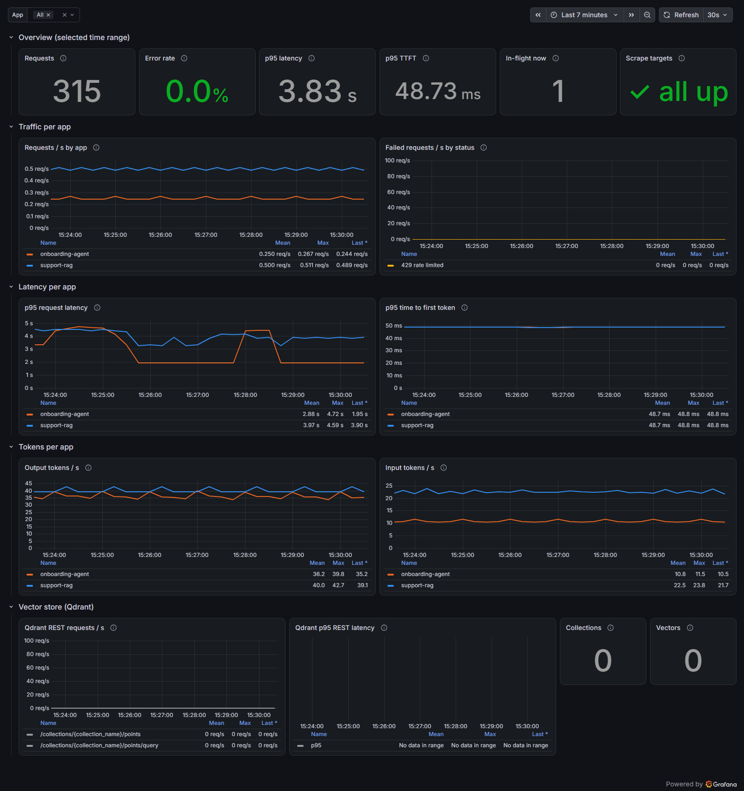
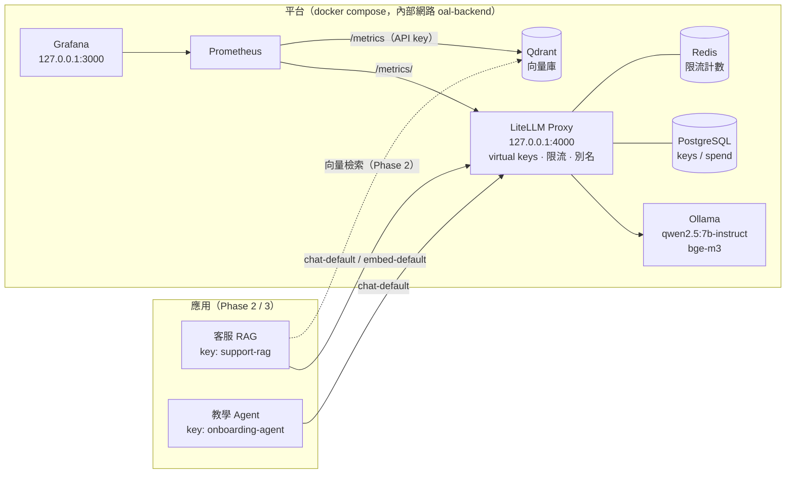

# onprem-agent-lab

地端 LLM 平台，以及跑在上面的兩個應用：攝影機產品客服 RAG、新人教學 Agent。

> 目前進度：**Phase 1（平台）完成**。Phase 2（客服 RAG）、Phase 3（教學 Agent）尚未開始。

## 摘要

**一句話**：在單機上用 LiteLLM Gateway 讓多個應用共用一張 GPU。每個應用一把 key，各有 rpm／tpm／並發上限，超量直接回 429。平台附監控、壓測與自動化驗證。

**關鍵數字**（RTX 4070 Ti、qwen2.5:7b-instruct、max_tokens 256，見〈[壓測與基準結果](#壓測與基準結果)〉）：

- **並發 4 即飽和**：等於 Ollama 的平行槽數 4。超過之後只會拉長排隊時間。
- **總吞吐約 275 tok/s**（並發 4）。
- **TTFT p95 0.15 s**（並發 4 以內）。

**驗證中的發現**（詳見〈[驗證中的發現](#驗證中的發現)〉）：

- **限流計數沒有共享到 Redis**：只設定 router 的 Redis 時，LiteLLM 1.83 仍把計數放在各 worker 的記憶體。已修正設定，並以測試確認計數寫進 Redis。
- **LiteLLM 1.83 的並發計數會被帶偏**：被拒的請求會讓計數加減，可能暫時超出並發上限，或誤回 429。這是上游 bug，目前以 `xfail(strict)` 測試追蹤。
- **Ollama 超載一次後，吞吐下降約一半**：2 個並發請求的總吞吐從約 160 降到約 76 tok/s，直到重啟 Ollama 才恢復。



<sub>Platform overview 儀表板，2026-11-27 15:23–15:30（UTC+8）。時間範圍內只有兩把正式 key 在限額內的一般流量，沒有測試或壓測流量；Qdrant 面板閒置，因為還沒有應用使用它。資料來源與重拍方式見 [`docs/dashboard-screenshot.md`](docs/dashboard-screenshot.md)。</sub>

## 目錄

1. [專案簡介](#專案簡介)
2. [架構](#架構)
3. [Quick Start](#quick-start)
4. [服務與 Port](#服務與-port)
5. [可觀測性](#可觀測性)
6. [測試](#測試)
7. [壓測與基準結果](#壓測與基準結果)
8. [驗證中的發現](#驗證中的發現)
9. [開發流程](#開發流程)
10. [安全性](#安全性)
11. [已知限制](#已知限制)
12. [Roadmap](#roadmap)
13. [授權](#授權)

## 專案簡介

這個專案在單機上建立一個**可替換推論後端的地端 LLM 平台**，讓多個應用共用同一組 GPU，而且不會互相搶資源：

- **推論後端**：目前用 Ollama，之後換成 vLLM。對外一律提供 OpenAI 相容 API。
- **LLM Gateway**：使用 LiteLLM Proxy。每個應用一把 virtual key，各自設定 rpm、tpm 與並發上限；超過上限時直接回 429，不會在 GPU 前面無限排隊。
- **穩定別名**：應用只呼叫 `chat-default`、`embed-default` 這兩個別名。換後端或換模型時，應用程式碼不用改。
- **其他元件**：Qdrant 向量庫；Prometheus + Grafana 監控，儀表板以程式碼定義（dashboards as code）。
- **品質保證**：平台的每一項要求都有 pytest 驗證，包括瀏覽器端的儀表板檢查；每個階段另由獨立的審閱者驗證（見〈[開發流程](#開發流程)〉）。

選擇地端的理由：
- **資料不出網**：客服知識庫與內部教材留在本機。
- **成本可預期**：成本固定在硬體上，不按 token 計費。
- **後端可替換**：Gateway 與別名把應用和後端隔開。

## 架構



- **對外只開兩個 port，而且都只綁 `127.0.0.1`**：Gateway（4000）與 Grafana（3000）。其他服務只在內部網路 `oal-backend` 上。應用不能直接連 Ollama，所有推論都要經過 Gateway 的限流。
- **並發預算**：設計預算為 4，等於 Ollama 的 `OLLAMA_NUM_PARALLEL=4`，由兩把應用 key 各分 2。這個預算受上游 bug 影響可能偏移（見〈[已知限制](#已知限制)〉）。壓測顯示吞吐量在並發 4 時飽和，見〈[壓測與基準結果](#壓測與基準結果)〉。
- **設定都放在版本控制**：
  - [`docker-compose.yml`](docker-compose.yml)：服務定義；可用 `docker-compose.gpu.yml` 啟用 GPU、用 `docker-compose.debug.yml` 開放除錯用 port；
  - [`infra/litellm/config.yaml`](infra/litellm/config.yaml)：模型別名；
  - [`infra/litellm/virtual-keys.toml`](infra/litellm/virtual-keys.toml)：各 key 的限額；
  - [`infra/grafana/build_dashboards.py`](infra/grafana/build_dashboards.py)：儀表板；
  - [`infra/prometheus/prometheus.yml`](infra/prometheus/prometheus.yml)：Prometheus 抓取設定。
- **密鑰**只存在 `.env`（不進版控）。

## Quick Start

**前置需求**

- Docker Desktop 或 Docker Engine，需含 Compose v2。
- NVIDIA GPU + NVIDIA Container Toolkit：可選，沒有就用 CPU（會很慢）。基準測試使用 RTX 4070 Ti 12 GB。
- Python 3.12 以上：執行腳本與測試用。
- [uv](https://docs.astral.sh/uv/)：管理測試用的 Python 環境（`pip install uv`）。
- 磁碟空間：模型約 6 GB（`qwen2.5:7b-instruct` 約 4.7 GB、`bge-m3` 約 1.2 GB），另需數 GB 給 image。

> **`uv` 不在 PATH 上？**（常見於 Windows：`pip install uv` 之後，`uv` 指令找不到）
> 那就把下面所有的 `uv ...` 換成 **`python -m uv ...`**，例如 `python -m uv sync`、`python -m uv run pytest`，效果相同。
> 本 README 的指令一律用 `python -m uv` 寫法，以免受 PATH 影響。

**1. 設定 `.env`**

```bash
cp .env.example .env
# 把每個 change-me 換成隨機值，例如：
python -c "import secrets; print(secrets.token_urlsafe(32))"
# LITELLM_MASTER_KEY 必須以 sk- 開頭；LITELLM_SALT_KEY 第一次啟動後就不要再改
```

**2. 啟動平台與監控**

```bash
# 有 NVIDIA GPU：
docker compose -f docker-compose.yml -f docker-compose.gpu.yml --profile platform --profile monitoring up -d
# 純 CPU：拿掉 -f docker-compose.gpu.yml。不要監控：拿掉 --profile monitoring
docker compose ps    # 等所有服務都是 healthy
```

第一次啟動時，`ollama-init` 會下載兩個模型，視網路速度需要數分鐘。下載完成後，它會以 `Exited (0)` 結束，這是正常的：

```bash
docker compose logs -f ollama-init
```

**3. 建立各應用的 virtual key**

```bash
python scripts/bootstrap_keys.py      # 依 virtual-keys.toml 建立或更新 key，寫入 .env；可重複執行
python scripts/bootstrap_keys.py --rotate   # 需要時強制換新 key
```

輸出中的 key 一律遮罩成 `sk-…末4碼`。完整的 key 只會寫進 `.env`。

**4. 確認可用**

經 Gateway 呼叫模型，回應的 `model` 應為 `chat-default`。

bash（Linux、macOS、Windows 的 Git Bash）：

```bash
set -a; . ./.env; set +a          # 把 .env 載入目前的 shell（不會印出任何值）
curl -s http://127.0.0.1:4000/v1/chat/completions \
  -H "Authorization: Bearer $SUPPORT_RAG_LLM_KEY" -H "Content-Type: application/json" \
  -d '{"model":"chat-default","messages":[{"role":"user","content":"Hello"}],"max_tokens":32}'
```

Windows PowerShell：

```powershell
# 把 .env 載入目前這個 PowerShell 視窗的環境變數（不會印出任何值）
Get-Content .env | Where-Object { $_ -match '^\s*([^#=\s]+)\s*=(.*)$' } | ForEach-Object { Set-Item "env:$($Matches[1])" $Matches[2].Trim() }
$body = '{"model":"chat-default","messages":[{"role":"user","content":"Hello"}],"max_tokens":32}'
Invoke-RestMethod http://127.0.0.1:4000/v1/chat/completions -Method Post `
  -Headers @{ Authorization = "Bearer $env:SUPPORT_RAG_LLM_KEY" } -ContentType 'application/json' -Body $body
```

> 範例的提示詞刻意只用 ASCII：在 Windows 的 Git Bash 中，命令列參數裡的中文會被轉碼，導致 JSON 錯誤。

- Grafana：<http://127.0.0.1:3000/d/platform-overview>，帳密是 `.env` 的 `GRAFANA_ADMIN_USER` / `GRAFANA_ADMIN_PASSWORD`。
- 想讓儀表板有資料，可以跑一段示範流量：`python loadtest/app_traffic.py --duration 300`。它使用正式 key，速率在限額內。

**5. 執行測試**（見〈測試〉）

```bash
python -m uv sync                             # 建立 .venv，安裝 pytest 與 Playwright
python -m uv run playwright install chromium  # 第一次執行瀏覽器測試前需要
python -m uv run pytest                       # 全部，約 5 分鐘
```

**停止**

- `docker compose --profile platform --profile monitoring stop` 只是停止服務，資料保留在 named volume。
- **`down -v` 會刪除所有資料**，包括已下載的模型、所有 key 與監控資料。

## 服務與 Port

| 服務 | Profile | Host Port | 用途 |
|---|---|---|---|
| postgres | platform | —（只在內網） | LiteLLM 的 key、spend、log |
| redis | platform | —（只在內網） | LiteLLM 的限流計數（需密碼） |
| ollama | platform | —（只在內網） | 推論後端（:11434；chat 走原生 `/api/chat`，embedding 走 OpenAI 相容的 `/v1`），應用不得直接連線 |
| ollama-init | platform | — | 一次性工作：拉取 `OLLAMA_CHAT_MODEL`、`OLLAMA_EMBED_MODEL` |
| litellm | platform | `127.0.0.1:4000` | LLM Gateway，應用唯一的入口（OpenAI 相容）；Admin UI 在 `/ui` |
| qdrant | platform | —（只在內網；除錯方式見下方） | 向量庫（REST :6333、gRPC :6334），需 `api-key`，telemetry 已關閉 |
| prometheus | monitoring | —（只在內網；除錯方式見下方） | 抓取 litellm 與 qdrant 的指標，保留 15 天 |
| grafana | monitoring | `127.0.0.1:3000` | 儀表板。帳密取自 `.env`；資料來源自動 provision；回報與更新檢查已關閉 |

**除錯用：暫時開放內部服務的 port**

需要從 host 檢查 Qdrant（例如開 `/dashboard`）或 Prometheus UI 時，加上 `docker-compose.debug.yml`：
- port 只綁 `127.0.0.1`；
- 可用 `.env` 的 `QDRANT_HTTP_PORT`、`QDRANT_GRPC_PORT`、`PROMETHEUS_PORT` 改 port 號。

```bash
docker compose -f docker-compose.yml -f docker-compose.gpu.yml -f docker-compose.debug.yml --profile platform up -d qdrant
# 除錯完要關閉：拿掉 debug override 再 up 一次
docker compose -f docker-compose.yml -f docker-compose.gpu.yml --profile platform up -d qdrant
```

應用一律呼叫 Gateway 的穩定別名，不直接指定後端模型：

| 別名 | 後端（目前） | 用途 |
|---|---|---|
| `chat-default` | Ollama `qwen2.5:7b-instruct` | 對話 / 生成 |
| `embed-default` | Ollama `bge-m3`（1024 維） | 向量化 |

### 每個應用一把 virtual key

限額定義在 [`infra/litellm/virtual-keys.toml`](infra/litellm/virtual-keys.toml)（limits as code），由 `scripts/bootstrap_keys.py` 套用。key 的值只寫進 `.env`。

| Key alias | 可用模型 | rpm | tpm | 並發 |
|---|---|---|---|---|
| `support-rag` | chat-default, embed-default | 60 | 100k | 2 |
| `onboarding-agent` | chat-default | 30 | 60k | 2 |

- 兩個應用的並發上限加總等於 Ollama 的 `OLLAMA_NUM_PARALLEL`（4）：單一 key 同時最多 2 個請求，另一個應用至少保有 2 個槽位。超額的請求由 Gateway 直接回 429。例外見〈已知限制〉中的並發計數漂移。
- 限流計數存在 Redis，可以跨 worker 與 replica 共享（見〈[驗證中的發現](#驗證中的發現)〉第 1 項）。為此啟用了 LiteLLM 的 Redis cache，但設成 `mode: default_off`，因此 **LLM 回應不會被快取**，除非請求明確帶 `cache: {"use-cache": true}`。

## 可觀測性

- **LiteLLM**：開啟 `prometheus` callback（免費版就有）。`/metrics/` 提供請求數、tokens、延遲、TTFT、進行中請求等指標，都帶 `api_key_alias` label，可以依應用拆分。
- **Qdrant**：`/metrics` 需要 API key。Prometheus 透過 compose secret 取得這把 key（值來自 `.env` 的 `QDRANT_API_KEY`），掛載為 `/run/secrets/qdrant_api_key`；設定檔裡只寫 `credentials_file`，不寫 key 本身。
- **Grafana**：資料來源由 `infra/grafana/provisioning/` 自動建立，唯讀。

### 儀表板（dashboards as code）

`http://127.0.0.1:3000/d/platform-overview`：由 [`infra/grafana/build_dashboards.py`](infra/grafana/build_dashboards.py) 產生 JSON，Grafana 以 provisioning 載入，所以不能在 UI 上修改。修改後執行：

```bash
python infra/grafana/build_dashboards.py --reload  # 重新產生 JSON，並通知 Grafana 重新載入
python infra/grafana/build_dashboards.py --check   # 給 CI / pytest 用：JSON 與產生器不一致就失敗
```

> 在 Windows／WSL 上，bind mount 不會把檔案變更事件傳進容器。實測 Grafana 的檔案監看與 `updateIntervalSeconds` 輪詢都偵測不到變更，
> 所以 `--reload` 直接呼叫 `POST /api/admin/provisioning/dashboards/reload`。pytest 會比對 Grafana 實際載入的查詢與 repo 內的 JSON，忘記 reload 就會失敗。

| 區塊 | 面板 |
|---|---|
| Overview（所選時間範圍） | Requests、Error rate、p95 latency、p95 TTFT、In-flight、Scrape targets |
| Traffic per app | Requests/s by app；Failed requests/s by status（429、401/403、5xx） |
| Latency per app | p95 request latency；p95 TTFT（只計串流請求） |
| Tokens per app | Output tokens/s；Input tokens/s |
| Vector store | Qdrant REST requests/s、p95 REST latency、Collections、Vectors |

設計規則（都由測試強制檢查）：
- **每個應用一個固定顏色**，所有面板都一樣：`support-rag` 藍 `#338ced`、`onboarding-agent` 橙 `#e76624`。這兩個顏色已在 Grafana 深色底 `#181b1f` 上驗證過色盲辨識度與對比。顏色跟著應用走，不會因為篩選或排名而改變。
- **狀態色只用於狀態**：429 黃、401/403 橘、5xx 紅、健康綠，從不用在應用的序列上。
- 每個面板只有一個 y 軸；圖例一律顯示應用名稱，不只靠顏色辨識。
- `App` 變數自動排除三類流量：測試用的臨時 key（`pytest-tmp-*`）、壓測用的臨時 key（`loadtest-*`），以及 master key 的流量（`None`）。
- Grafana 預設深色主題，因為配色是以深色底驗證的。

讀數看起來奇怪時（例如面板短暫沒有資料、In-flight 顯示 1），先看 [`docs/observability-notes.md`](docs/observability-notes.md)。README 截圖的重拍步驟在 [`docs/dashboard-screenshot.md`](docs/dashboard-screenshot.md)。

## 測試

**前提**：
- 平台與監控都已啟動（`--profile platform --profile monitoring`）；
- `.env` 已填好；
- 已執行過 `bootstrap_keys.py`。

```bash
python -m uv sync
python -m uv run playwright install chromium     # 第一次需要（瀏覽器測試用）
python -m uv run pytest                          # 全部，約 5 分鐘
python -m uv run pytest -m "not llm"             # 跳過會呼叫模型的測試，包括 Grafana e2e（約 20 秒）
python -m uv run pytest tests/e2e                # 只跑 Grafana 瀏覽器檢查（約 2.5 分鐘）
```

各路徑的測試數量（`pytest --collect-only` 的結果，由 `test_readme.py` 檢查與實際一致）：

| 路徑 | 測試數 | 指令 | 內容 |
|---|---:|---|---|
| `tests/platform` | 168（含 1 個 xfail） | `python -m uv run pytest tests/platform` | 容器、gateway、key、監控、儀表板 API、Qdrant、壓測工具、README 與 repo 衛生 |
| `tests/e2e` | 22 | `python -m uv run pytest tests/e2e` | Playwright 瀏覽器檢查 Grafana 儀表板（需要 chromium） |
| 全部（`tests`） | 190 | `python -m uv run pytest` | 上面兩者合計 |

只跑 `tests/platform` 時，結果是「167 passed, 1 xfailed」，不包含 e2e 的 22 個測試；完整套件是「189 passed, 1 xfailed」。

| 檔案 | 驗證內容 |
|---|---|
| `tests/platform/test_repo_hygiene.py` | `.env` 與壓測結果不進版控；追蹤中的檔案沒有密鑰值；`.sh` 檔為 LF；image 都釘了版本；`.env` 與 gateway 的模型名一致；`env` fixture 不會洩漏密鑰；原始輸出一律經 `scripts/rawlog.py` 遮罩，`reports/` 底下沒有密鑰或未遮罩的 key |
| `tests/platform/test_containers.py` | 服務都是 healthy、ollama-init 以 0 結束、**只有 gateway 與 Grafana 對 host 開 port，而且只綁 127.0.0.1**、使用 named volume、Redis 拒絕未認證連線、Qdrant telemetry 已關閉 |
| `tests/platform/test_gateway.py` | readiness（db + redis）、錯誤的 key 回 401、模型清單只有別名、chat／串流／embedding（1024 維）、每一筆 chat（含串流）都有自己的 spend log 紀錄 |
| `tests/platform/test_virtual_keys.py` | key 的限額與 `virtual-keys.toml` 一致、模型白名單、rpm／tpm／並發會觸發 429、限流計數存在 Redis、回應不被快取、bootstrap 可重複執行且輸出只含 `sk-…末4碼` |
| `tests/platform/test_monitoring.py` | Prometheus 的 target 全部 up、Qdrant 的抓取使用 secret 檔、gateway 請求依 `api_key_alias` 出現在 Prometheus、Grafana 需要登入、資料來源已 provision 且健康、回報已關閉 |
| `tests/platform/test_dashboards.py` | JSON 與產生器一致、Grafana 實際載入的就是 repo 版本、每個面板的查詢都能執行、真實應用的流量／429／TTFT 會出現在對應面板、閒置時 In-flight 為 0、固定配色規則；另有 1 個 `xfail(strict)` 測試追蹤 LiteLLM 的上游 bug |
| `tests/platform/test_qdrant.py` | 健康檢查不需驗證、資料 API 需要 key、gateway embedding → Qdrant 寫入 → 查詢的端到端流程 |
| `tests/platform/test_loadtest.py` | 壓測工具的指標定義（用假的 SSE 伺服器驗證 TTFT 與 decode 公式）、percentile 計算、臨時 key 一定會被刪除（含失敗路徑）、示範流量不超過限額、一次小型端到端壓測 |
| `tests/platform/test_container_logs.py` | 在整個測試 session 的最後執行：LiteLLM 容器 log 中沒有任何應用 key、master key 或 `sk-` 形式的 token |
| `tests/e2e/test_grafana.py` | 以 Playwright 透過登入表單登入、用 kiosk 模式開啟儀表板並截圖：沒有任何面板顯示 No data、時間序列有實際資料點、面板不重疊也不超出畫面 |

設計重點：
- **內部服務**沒有 host port。測試會啟動臨時的 probe 容器（`python:3.12.16-alpine3.24`），在 `oal-backend` 網路內發 HTTP 請求；請求內容（含密鑰）經 stdin 傳入，不會出現在命令列。
- **限流測試**使用臨時 key（前綴 `pytest-tmp-`，限額極小），測完就刪除。應用的正式 key 只讀不改。
- **測試語言**：一律用 Python 撰寫，避免不同 shell 的引號差異。

## 壓測與基準結果

```bash
python loadtest/bench.py --restart-backend      # 並發 1,2,4,8,16；結果寫入 loadtest/results/<時間>/（不進版控）
python loadtest/bench.py -c 1,4 -n 8 --max-tokens 64   # 快速版
python loadtest/bench.py --key-env SUPPORT_RAG_LLM_KEY # 套用應用的限額（可以看到 429）
python loadtest/repro_degradation.py            # 重現「超載後吞吐下降」（見〈驗證中的發現〉第 3 項）
```

- 所有請求都以串流方式經過 Gateway，在客戶端量測：
  - TTFT；
  - 總延遲；
  - 每個請求的生成速度（decode tok/s）；
  - 整體吞吐量。
- p50／p95 只計算成功的請求；429 與其他錯誤另外計數。
- 預設會建立臨時 key（`loadtest-*`，無限額）。結束時會刪除這把 key，並確認刪除成功；刪除失敗時以結束碼 3 回報。這個預設量的是平台容量，不是應用配額。
- `--restart-backend` 會在每個並發等級開始前重啟 Ollama 並暖機，讓每一級都從相同狀態開始（原因見〈驗證中的發現〉第 3 項）。

**目前的基準**（2026-11-27，chat 走 `ollama_chat/`；RTX 4070 Ti、qwen2.5:7b-instruct、`OLLAMA_NUM_PARALLEL=4`、max_tokens 256）。完整報告與「provider 變更前後比較」見 [`docs/benchmarks/2026-11-27-ollama-chat.md`](docs/benchmarks/2026-11-27-ollama-chat.md)；第一版基準（經 `/v1`）與方法說明見 [`docs/benchmarks/2026-11-26-baseline.md`](docs/benchmarks/2026-11-26-baseline.md)：

| 並發 | TTFT p50 | TTFT p95 | 延遲 p95 | 每請求 tok/s | 總吞吐 tok/s |
|---:|---:|---:|---:|---:|---:|
| 1 | 0.039 s | 0.054 s | 3.15 s | 82.5 | 81.7 |
| 2 | 0.070 s | 0.075 s | 3.37 s | 77.3 | 152.1 |
| 4 | 0.121 s | 0.147 s | 3.78 s | 71.1 | 275.5 |
| 8 | 3.742 s | 3.780 s | 7.41 s | 70.3 | 277.5 |
| 16 | 11.458 s | 11.569 s | 15.24 s | 68.5 | 269.8 |

- **吞吐量在並發 4 時飽和**，4 剛好就是 Ollama 的平行槽數。再增加並發只會拉長排隊時間，TTFT 隨之線性上升。因此兩把應用 key 的並發上限加總設為 4，超量時由 Gateway 立即回 429。
- **和改用 `ollama_chat/` 之前（經 `/v1`）相比**：差異在 10% 以內、飽和點仍為並發 4；但新設定每一級吞吐皆略低 1–6.5%，方向一致，推測為 LiteLLM 轉換 Ollama 原生串流格式的開銷，尚未驗證（每種設定各只跑一輪）。TTFT p95 在並發 2／4 的差異超過 10%，但方向相反，絕對值只有 11–15 ms，判斷為小樣本雜訊。
- **測試條件的限制**：
  - 測試機是同時在跑其他程式的桌機；
  - 每一級只跑一輪，樣本也小；
  - 所有回答都被 `max_tokens=256` 截斷。

## 驗證中的發現

平台在驗證過程中發現的三個問題。每一項都列出現象、如何定位、處理方式與對應的測試。

### 1. 限流計數沒有共享到 Redis

- **現象**：只在 `router_settings` 設定 Redis 時，LiteLLM 1.83 的 rpm／tpm／並發計數仍放在各 worker 的記憶體裡。多 worker 或多 replica 時，每個程序各算各的，限額實際上會被放大。
- **如何定位**：驗證 1.5 時，送出請求後 Redis 裡一個 key 都沒有（`dbsize=0`）。接著在容器內搜尋 LiteLLM 1.83 的原始碼，發現限流器只透過 `litellm.cache` 取得 Redis，`router_settings` 的 Redis 只給 router 自己用。
- **處理方式**：在 [`infra/litellm/config.yaml`](infra/litellm/config.yaml) 啟用 Redis cache，讓計數寫進 Redis。同時設成 `mode: default_off`，所以 LLM 回應預設不會被快取。
- **對應測試**：
  - `tests/platform/test_virtual_keys.py::test_limiter_counters_in_redis`：送出請求後，Redis 中要有這把 key 的計數；
  - `test_responses_not_cached_by_default`：同樣的請求送兩次，回應不能是快取。

### 2. LiteLLM 1.83 的並發計數錯誤（上游 bug）

- **現象**：在 LiteLLM 1.83.14 上，被拒絕的請求會改變 key 的並發計數，但不會反向恢復：
  - 「模型不在白名單」的 401，每次讓計數 −1。實測計數到 −3 後，上限 2 的 key 同時 3 條串流都被接受。
  - 格式錯誤的 400，每次讓計數 +1。累積到 +2 之後，即使沒有任何請求在進行，正常請求也會被回 429。
  - 計數的 TTL 為 60 秒，每次更新都會重設。
- **如何定位**：在 1.9 調查儀表板的過程中，讀到 `onboarding-agent` 在 Redis 的並發計數是 −2；實測佔住 2 條串流後，第 3 個請求仍回 200。接著把計數歸零，用臨時 key 逐一送出各種會被拒的請求，在每一步讀取計數與 TTL，找出 401 與 400 兩種漂移方向。
- **處理方式**：
  - 尚未修正，等上游處理；
  - 總並發仍受 Ollama `OLLAMA_NUM_PARALLEL=4` 的硬上限保護；
  - 重現腳本與分析在 [`docs/upstream/litellm-parallel-counter.md`](docs/upstream/litellm-parallel-counter.md)。
- **對應測試**：
  - `tests/platform/test_dashboards.py::test_auth_rejection_does_not_skew_parallel_counter`：標為 `xfail(strict=True)`，上游修正後會轉為失敗，提醒我們更新；
  - `test_auth_rejections_are_not_metered`：釘住「401 不計入指標」這個相關行為。

### 3. Ollama 超載後吞吐下降約一半

- **現象**：Ollama 0.40.18 處理過一次超過槽位數的並發後，2 個同時進行的請求吞吐量會大幅下降，直到重啟 Ollama 才恢復。兩種設定各實測兩輪：
  - `/v1`（舊）：下降 46–53%（約 165 → 77–89 tok/s）。退化不一定立即出現：有一輪剛超載時只有部分請求變慢。
  - `ollama_chat/`（目前）：下降 52–53%（約 159–161 → 75–77 tok/s）。兩輪都是超載後立即全部變慢。
  - 並發 1 與並發 4 都不受影響。所以這個問題與 gateway 走哪一個 Ollama API 無關。
- **如何定位**：
  - 第一版壓測把各並發等級連續執行，並發 2 的數字明顯偏低，而且無法重現。
  - 改用 `loadtest/repro_degradation.py` 固定順序重現：重啟 → 並發 2 → 並發 8 超載 → 並發 2 ×2 → 並發 4 → 並發 1 → 重啟後並發 2。
  - 結果顯示，同一個未重啟的 LiteLLM，只重啟 Ollama 就完全恢復，所以造成變慢的狀態在 Ollama 程序內。
- **處理方式**：
  - 壓測改用 `--restart-backend`，讓每一級都從相同狀態開始；
  - 兩把應用 key 的並發上限加總維持在 4，避免一般流量讓 Ollama 超載；
  - 偵測告警與定期重啟等緩解選項尚未實作，見基準報告的〈Operational risk〉一節；
  - 換成 vLLM 後用同一支腳本重測。
  - 並列數字見 [`docs/benchmarks/2026-11-27-ollama-chat.md`](docs/benchmarks/2026-11-27-ollama-chat.md)。
- **對應測試**：這個現象需要重啟 Ollama、每次數分鐘，沒有做成自動化的行為測試，改用 `repro_degradation.py` 重現。文件中的數字由以下測試和原始資料比對：
  - `tests/platform/test_readme.py::test_ops_risk_numbers_match_degradation_data`
  - `test_degradation_comparison_matches_both_raw_runs`

  並發預算等於槽位數，由 `tests/platform/test_virtual_keys.py::test_parallel_budget_matches_ollama_capacity` 檢查。

## 開發流程

- **開發**：以 Claude Code 實作，每完成一個小步驟就 commit。專案規則寫在 [`CLAUDE.md`](CLAUDE.md)。
- **獨立驗證**：每個階段完成後，交給 Codex 以唯讀模式獨立驗證（[`scripts/overnight/run_codex.py`](scripts/overnight/run_codex.py)）。不通過就修正後再驗，直到通過。
- **報告存放位置**：
  - 驗證報告在 [`reports/verification/`](reports/verification/)，每個階段一份，包含 Codex 的回覆與修正對照；
  - 測試輸出、截圖、壓測原始資料等證據，遮罩後放在 [`reports/evidence/`](reports/evidence/)；
  - Agent 的原始對話紀錄只留在本機，不進版控。

## 安全性

- 所有密鑰只放在 `.env`（已列入 `.gitignore`），版本控制中只有 `.env.example`。
- 設定檔（例如 `infra/litellm/config.yaml`）只透過 `os.environ/...` 引用密鑰，不寫明文。
- 腳本輸出的 key 一律遮罩為 **`sk-` + `…` + 末 4 碼**（例如 `sk-…AbCd`，這是虛構的範例）：
  - 前 3 碼固定是 `sk-`，沒有辨識度；
  - 末 4 碼足以區分不同的 key，也是業界常見做法；
  - 完整的 key 只寫進 `.env`。
- 測試輸出也防止洩漏密鑰：
  - `env` fixture 的 repr 只顯示變數名稱；
  - 原始輸出（本機的 `reports/raw/`，不進版控）與壓測結果一律經 `scripts/rawlog.py` 遮罩後才寫檔：
    - 所有 `.env` 密鑰值換成 `[REDACTED]`；
    - `sk-` token 換成 `sk-…末4碼`；
    - 本機身分資訊（使用者目錄路徑、帳號名稱、email）換成 `<HOME>`、`<user>`、`<email>`。
  - 報告引用的證據遮罩後放在 `reports/evidence/`。Agent 的原始對話紀錄（`codex*.log`）只留在本機，不進版控。
  - shell 指令的輸出用 `<指令> | python -I scripts/rawlog.py <檔案>` 取代 `>` 或 `tee`。測試會靜態檢查寫檔程式都經過它，並掃描 `reports/` 底下所有檔案。
- key 只放在 `Authorization` header 或 JSON body，不放在 URL query：LiteLLM 的 access log 會記下完整的請求行。查詢某把 key 的資訊時，用該 key 本身呼叫 `GET /key/info`（不帶 `?key=`）。`tests/platform/test_container_logs.py` 在完整測試的最後掃描 `docker compose logs litellm`，確認沒有任何 key。
- 只有 Gateway 與 Grafana 對 host 開放，而且只綁 `127.0.0.1`。Postgres、Redis、Ollama、Qdrant、Prometheus 預設都不對 host 開 port（除錯用的 override 見〈服務與 Port〉）。
- LiteLLM 的 `/metrics/` 不需要驗證，Prometheus 因此不必持有 master key。也因為這樣，它只能從內網與本機 loopback 存取。
- Qdrant 的資料與 collection API 都需要 `api-key`；只有健康檢查（`/healthz`、`/readyz`、`/livez`）不需驗證。

## 已知限制

以下只列尚未解決的部分。已定位的問題與處理方式見〈[驗證中的發現](#驗證中的發現)〉。

**Gateway 與指標**

- **並發計數會漂移（上游 bug，未修正）**：被拒的請求會讓 LiteLLM 1.83 的並發計數偏移，可能暫時超出或誤擋並發上限，所以實際並發預算可能偏離 4。總並發仍受 Ollama 的硬上限保護。詳見〈驗證中的發現〉第 2 項。
- **`/metrics/` 不需驗證**：LiteLLM 的 `/metrics/` 目前只靠網路隔離保護（只有內網與 `127.0.0.1` 能連到）。之後若加上 Nginx 等反向代理對外開放，**必須在代理層阻擋外部存取 `/metrics`**。
- **認證階段被拒的請求不計量**：LiteLLM 1.83 不會把 401（key 錯誤、模型不在白名單）記入指標，所以 Error rate 與 Failed requests 面板看不到這類錯誤。另外，格式錯誤的請求雖然回 400，在指標中的狀態卻記成 `None`。
- **串流 chunk 的 id 不一致**：
  - 為了讓每一筆 chat 都寫進 spend log，`chat-default` 改走 LiteLLM 的 `ollama_chat/` provider。原因是 Ollama `/v1` 回傳的 id 只有 `chatcmpl-<0–999>`，會在 spend log 主鍵上碰撞而被丟掉。
  - 副作用是串流回應中**每個 chunk 的 id 都不同**，不符合 OpenAI 規格；只依 id 合併 chunk 的 client 會出錯。
  - 換成 vLLM 後改回 `openai/` 即可解決。
  - 調查與重現見 [`reports/evidence/spendlog/FINDINGS.md`](reports/evidence/spendlog/FINDINGS.md)。
- **spend log 曾短暫停止寫入，原因未確認**：2026-11-26 曾觀察到約 10 分鐘完全沒有寫入，之後未再重現。紀錄見 [`reports/evidence/incidents/spendlog-stall.txt`](reports/evidence/incidents/spendlog-stall.txt)。

**推論與監控**

- **Ollama 超載後吞吐下降，需重啟才恢復**：緩解措施尚未實作。詳見〈驗證中的發現〉第 3 項。
- **沒有推論端指標**：Ollama 不提供 Prometheus 指標，GPU 與佇列等推論端指標要等換成 vLLM 後才補齊。
- 儀表板讀數與測試的其他注意事項（新序列的第一個樣本、In-flight 短暫顯示 1、重啟 LiteLLM 後的短暫誤判等）見 [`docs/observability-notes.md`](docs/observability-notes.md)。

## Roadmap

- [x] Phase 1：平台（推論、Gateway、向量庫、監控、壓測）
- [ ] Phase 2：應用 A，產品客服 RAG。章節切塊、hybrid search + rerank、回答附出處、分數過低時拒答，加上 RAG 評測集
- [ ] Phase 3：應用 B，新人教學 Agent。YAML 課程、Docker 沙盒檢查、MCP 工具
- [ ] 推論後端換成 vLLM，並用同一套壓測與 `repro_degradation.py` 重新量測

## 授權

[MIT License](LICENSE)，作者 Jun-Hao Lin。
