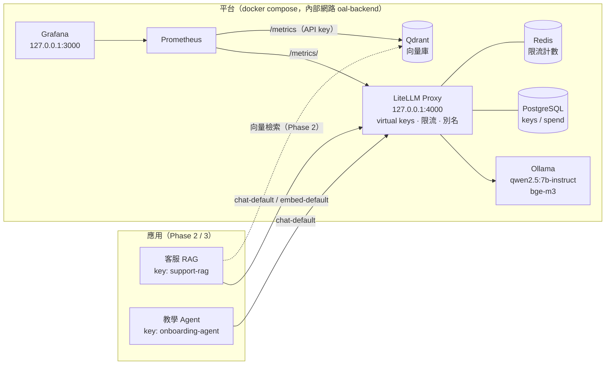

# onprem-agent-lab

地端 LLM 平台，以及跑在上面的兩個應用：攝影機產品客服 RAG、新人教學 Agent。

> 🚧 開發中。目前進度：**Phase 1（平台）完成**。Phase 2（客服 RAG）、Phase 3（教學 Agent）尚未開始。


<sub>截圖說明：
- 截圖時間範圍為最近 10 分鐘，時間軸使用瀏覽器時區（UTC+8）。
- 右側的 LLM 流量來自 `loadtest/app_traffic.py`：以兩把正式 key 送出，速率在各自限額內，全部回 200。
- Qdrant 面板的資料來自測試套件，因為 RAG 應用尚未實作。
- 資料來源的細節見 [`reports/raw/D/screenshot.txt`](reports/raw/D/screenshot.txt)。</sub>

## 目錄

1. [專案簡介](#專案簡介)
2. [架構](#架構)
3. [Quick Start](#quick-start)
4. [服務與 Port](#服務與-port)
5. [可觀測性](#可觀測性)
6. [測試](#測試)
7. [壓測與基準結果](#壓測與基準結果)
8. [安全性](#安全性)
9. [已知限制](#已知限制)
10. [Roadmap](#roadmap)

## 專案簡介

這個專案在單機上建立一個**可替換推論後端的地端 LLM 平台**，讓多個應用共用同一組 GPU，而且不會互相搶資源：

- **推論後端**：目前用 Ollama，之後換成 vLLM。對外一律提供 OpenAI 相容 API。
- **LLM Gateway**：使用 LiteLLM Proxy。每個應用一把 virtual key，各自設定 rpm、tpm 與並發上限；超過上限時直接回 429，不會在 GPU 前面無限排隊。
- **穩定別名**：應用只呼叫 `chat-default`、`embed-default` 這兩個別名。換後端或換模型時，應用程式碼不用改。
- **其他元件**：Qdrant 向量庫；Prometheus + Grafana 監控，儀表板以程式碼定義（dashboards as code）。
- **品質保證**：
  - 平台的每一項要求都有 pytest 驗證，包括瀏覽器端的儀表板檢查；
  - 有壓測工具與基準報告；
  - 每個階段都另外由獨立的審閱者（Codex）驗證，報告在 [`reports/verification/`](reports/verification/)。

選擇地端的理由：
- **資料不出網**：客服知識庫與內部教材留在本機。
- **成本可預期**：成本固定在硬體上，不按 token 計費。
- **後端可替換**：Gateway 與別名把應用和後端隔開。

## 架構



- **對外只開兩個 port，而且都只綁 `127.0.0.1`**：Gateway（4000）與 Grafana（3000）。其他服務只在內部網路 `oal-backend` 上。應用不能直接連 Ollama，所有推論都要經過 Gateway 的限流。
- **並發預算**：Ollama 有 `OLLAMA_NUM_PARALLEL=4` 個平行處理槽位。兩把應用 key 的並發上限是 2 + 2 = 4，加總剛好等於槽位數，所以一個應用無法佔滿 GPU。壓測證實吞吐量在並發 4 時就已飽和，見〈壓測與基準結果〉。
- **設定都放在版本控制**：
  - [`docker-compose.yml`](docker-compose.yml)：服務定義；可用 `docker-compose.gpu.yml` 啟用 GPU、用 `docker-compose.debug.yml` 開放除錯用 port；
  - [`infra/litellm/config.yaml`](infra/litellm/config.yaml)：模型別名；
  - [`infra/litellm/virtual-keys.toml`](infra/litellm/virtual-keys.toml)：各 key 的限額；
  - [`infra/grafana/build_dashboards.py`](infra/grafana/build_dashboards.py)：儀表板；
  - [`infra/prometheus/prometheus.yml`](infra/prometheus/prometheus.yml)：Prometheus 抓取設定。
- **密鑰**只存在 `.env`（不進版控）。

## Quick Start

**前置需求**

- Docker Desktop 或 Docker Engine，需含 Compose v2。
- NVIDIA GPU + NVIDIA Container Toolkit：可選，沒有就用 CPU（會很慢）。基準測試使用 RTX 4070 Ti 12 GB。
- Python 3.12 以上：執行腳本與測試用。
- [uv](https://docs.astral.sh/uv/)：管理測試用的 Python 環境（`pip install uv`）。
- 磁碟空間：模型約 6 GB（`qwen2.5:7b-instruct` 約 4.7 GB、`bge-m3` 約 1.2 GB），另需數 GB 給 image。

> **`uv` 不在 PATH 上？**（常見於 Windows：`pip install uv` 之後，`uv` 指令找不到）
> 那就把下面所有的 `uv ...` 換成 **`python -m uv ...`**，例如 `python -m uv sync`、`python -m uv run pytest`，效果相同。
> 本 README 的指令一律用 `python -m uv` 寫法，以免受 PATH 影響。

**1. 設定 `.env`**

```bash
cp .env.example .env
# 把每個 change-me 換成隨機值，例如：
python -c "import secrets; print(secrets.token_urlsafe(32))"
# LITELLM_MASTER_KEY 必須以 sk- 開頭；LITELLM_SALT_KEY 第一次啟動後就不要再改
```

**2. 啟動平台與監控**

```bash
# 有 NVIDIA GPU：
docker compose -f docker-compose.yml -f docker-compose.gpu.yml --profile platform --profile monitoring up -d
# 純 CPU：拿掉 -f docker-compose.gpu.yml。不要監控：拿掉 --profile monitoring
docker compose ps    # 等所有服務都是 healthy
```

第一次啟動時，`ollama-init` 會下載兩個模型，視網路速度需要數分鐘。下載完成後，它會以 `Exited (0)` 結束，這是正常的：

```bash
docker compose logs -f ollama-init
```

**3. 建立各應用的 virtual key**

```bash
python scripts/bootstrap_keys.py      # 依 virtual-keys.toml 建立或更新 key，寫入 .env；可重複執行
python scripts/bootstrap_keys.py --rotate   # 需要時強制換新 key
```

輸出中的 key 一律遮罩成 `sk-…末4碼`。完整的 key 只會寫進 `.env`。

**4. 確認可用**

```bash
# 經 Gateway 呼叫模型（bash；Windows PowerShell 請改用 curl.exe，並注意引號）
set -a; . ./.env; set +a          # 把 .env 載入目前的 shell（不會印出任何值）
curl -s http://127.0.0.1:4000/v1/chat/completions \
  -H "Authorization: Bearer $SUPPORT_RAG_LLM_KEY" -H "Content-Type: application/json" \
  -d '{"model":"chat-default","messages":[{"role":"user","content":"Hello"}],"max_tokens":32}'
```

- Grafana：<http://127.0.0.1:3000/d/platform-overview>，帳密是 `.env` 的 `GRAFANA_ADMIN_USER` / `GRAFANA_ADMIN_PASSWORD`。
- 想讓儀表板有資料，可以跑一段示範流量：`python loadtest/app_traffic.py --duration 300`。它使用正式 key，速率在限額內。

**5. 執行測試**（見〈測試〉）

```bash
python -m uv sync                             # 建立 .venv，安裝 pytest 與 Playwright
python -m uv run playwright install chromium  # 第一次執行瀏覽器測試前需要
python -m uv run pytest                       # 全部，約 5 分鐘
```

**停止**

- `docker compose --profile platform --profile monitoring stop` 只是停止服務，資料保留在 named volume。
- **`down -v` 會刪除所有資料**，包括已下載的模型、所有 key 與監控資料。

## 服務與 Port

| 服務 | Profile | Host Port | 用途 |
|---|---|---|---|
| postgres | platform | —（只在內網） | LiteLLM 的 key、spend、log |
| redis | platform | —（只在內網） | LiteLLM 的限流計數（需密碼） |
| ollama | platform | —（只在內網） | 推論後端（OpenAI 相容 API :11434），應用不得直接連線 |
| ollama-init | platform | — | 一次性工作：拉取 `OLLAMA_CHAT_MODEL`、`OLLAMA_EMBED_MODEL` |
| litellm | platform | `127.0.0.1:4000` | LLM Gateway，應用唯一的入口（OpenAI 相容）；Admin UI 在 `/ui` |
| qdrant | platform | —（只在內網；除錯方式見下方） | 向量庫（REST :6333、gRPC :6334），需 `api-key`，telemetry 已關閉 |
| prometheus | monitoring | —（只在內網；除錯方式見下方） | 抓取 litellm 與 qdrant 的指標，保留 15 天 |
| grafana | monitoring | `127.0.0.1:3000` | 儀表板。帳密取自 `.env`；資料來源自動 provision；回報與更新檢查已關閉 |

**除錯用：暫時開放內部服務的 port**

需要從 host 檢查 Qdrant（例如開 `/dashboard`）或 Prometheus UI 時，加上 `docker-compose.debug.yml`：
- port 只綁 `127.0.0.1`；
- 可用 `.env` 的 `QDRANT_HTTP_PORT`、`QDRANT_GRPC_PORT`、`PROMETHEUS_PORT` 改 port 號。

```bash
docker compose -f docker-compose.yml -f docker-compose.gpu.yml -f docker-compose.debug.yml --profile platform up -d qdrant
# 除錯完要關閉：拿掉 debug override 再 up 一次
docker compose -f docker-compose.yml -f docker-compose.gpu.yml --profile platform up -d qdrant
```

應用一律呼叫 Gateway 的穩定別名，不直接指定後端模型：

| 別名 | 後端（目前） | 用途 |
|---|---|---|
| `chat-default` | Ollama `qwen2.5:7b-instruct` | 對話 / 生成 |
| `embed-default` | Ollama `bge-m3`（1024 維） | 向量化 |

### 每個應用一把 virtual key

限額定義在 [`infra/litellm/virtual-keys.toml`](infra/litellm/virtual-keys.toml)（limits as code），由 `scripts/bootstrap_keys.py` 套用。key 的值只寫進 `.env`。

| Key alias | 可用模型 | rpm | tpm | 並發 |
|---|---|---|---|---|
| `support-rag` | chat-default, embed-default | 60 | 100k | 2 |
| `onboarding-agent` | chat-default | 30 | 60k | 2 |

- 兩個應用的並發上限加總等於 Ollama 的 `OLLAMA_NUM_PARALLEL`（4），所以一個應用無法佔滿推論資源。超額的請求由 Gateway 直接回 429。
- 限流計數存在 Redis，可以跨 worker 與 replica 共享。為此啟用了 LiteLLM 的 Redis cache，但設成 `mode: default_off`，因此 **LLM 回應不會被快取**，除非請求明確帶 `cache: {"use-cache": true}`。

## 可觀測性

- **LiteLLM**：開啟 `prometheus` callback（免費版就有）。`/metrics/` 提供請求數、tokens、延遲、TTFT、進行中請求等指標，都帶 `api_key_alias` label，可以依應用拆分。
- **Qdrant**：`/metrics` 需要 API key。Prometheus 透過 compose secret 取得這把 key（值來自 `.env` 的 `QDRANT_API_KEY`），掛載為 `/run/secrets/qdrant_api_key`；設定檔裡只寫 `credentials_file`，不寫 key 本身。
- **Grafana**：資料來源由 `infra/grafana/provisioning/` 自動建立，唯讀。

### 儀表板（dashboards as code）

`http://127.0.0.1:3000/d/platform-overview`：由 [`infra/grafana/build_dashboards.py`](infra/grafana/build_dashboards.py) 產生 JSON，Grafana 以 provisioning 載入，所以不能在 UI 上修改。修改後執行：

```bash
python infra/grafana/build_dashboards.py --reload  # 重新產生 JSON，並通知 Grafana 重新載入
python infra/grafana/build_dashboards.py --check   # 給 CI / pytest 用：JSON 與產生器不一致就失敗
```

> 在 Windows／WSL 上，bind mount 不會把檔案變更事件傳進容器。實測 Grafana 的檔案監看與 `updateIntervalSeconds` 輪詢都偵測不到變更，
> 所以 `--reload` 直接呼叫 `POST /api/admin/provisioning/dashboards/reload`。pytest 會比對 Grafana 實際載入的查詢與 repo 內的 JSON，忘記 reload 就會失敗。

| 區塊 | 面板 |
|---|---|
| Overview（所選時間範圍） | Requests、Error rate、p95 latency、p95 TTFT、In-flight、Scrape targets |
| Traffic per app | Requests/s by app；Failed requests/s by status（429、401/403、5xx） |
| Latency per app | p95 request latency；p95 TTFT（只計串流請求） |
| Tokens per app | Output tokens/s；Input tokens/s |
| Vector store | Qdrant REST requests/s、p95 REST latency、Collections、Vectors |

設計規則（都由測試強制檢查）：
- **每個應用一個固定顏色**，所有面板都一樣：`support-rag` 藍 `#338ced`、`onboarding-agent` 橙 `#e76624`。這兩個顏色已在 Grafana 深色底 `#181b1f` 上驗證過色盲辨識度與對比。顏色跟著應用走，不會因為篩選或排名而改變。
- **狀態色只用於狀態**：429 黃、401/403 橘、5xx 紅、健康綠，從不用在應用的序列上。
- 每個面板只有一個 y 軸；圖例一律顯示應用名稱，不只靠顏色辨識。
- `App` 變數自動排除三類流量：測試用的臨時 key（`pytest-tmp-*`）、壓測用的臨時 key（`loadtest-*`），以及 master key 的流量（`None`）。
- Grafana 預設深色主題，因為配色是以深色底驗證的。
- Ollama 本身不提供 Prometheus 指標；推論端的指標要等換成 vLLM 後才補齊。

重新產生 README 截圖的步驟：

```bash
python loadtest/app_traffic.py --duration 300                  # 先跑一段正式 key 流量
python -m uv run python scripts/screenshot_dashboard.py --range 10m
```

`screenshot_dashboard.py` 會用 Playwright 的 kiosk 模式截圖。只要有任何面板沒有資料，就不會寫入 `docs/images/dashboard.png`。

## 測試

**前提**：
- 平台與監控都已啟動（`--profile platform --profile monitoring`）；
- `.env` 已填好；
- 已執行過 `bootstrap_keys.py`。

```bash
python -m uv sync
python -m uv run playwright install chromium     # 第一次需要（瀏覽器測試用）
python -m uv run pytest                          # 全部，約 5 分鐘
python -m uv run pytest -m "not llm"             # 跳過會呼叫模型的測試（約 20 秒）
python -m uv run pytest tests/e2e                # 只跑 Grafana 瀏覽器檢查（約 2.5 分鐘）
```

| 檔案 | 驗證內容 |
|---|---|
| `tests/platform/test_repo_hygiene.py` | `.env` 與壓測結果不進版控；追蹤中的檔案沒有密鑰值；`.sh` 檔為 LF；image 都釘了版本；`.env` 與 gateway 的模型名一致；`env` fixture 與 pytest 輸出 wrapper 不會洩漏密鑰 |
| `tests/platform/test_containers.py` | 服務都是 healthy、ollama-init 以 0 結束、**只有 gateway 與 Grafana 對 host 開 port，而且只綁 127.0.0.1**、使用 named volume、Redis 拒絕未認證連線、Qdrant telemetry 已關閉 |
| `tests/platform/test_gateway.py` | readiness（db + redis）、錯誤的 key 回 401、模型清單只有別名、chat／串流／embedding（1024 維）、spend log 有寫入 |
| `tests/platform/test_virtual_keys.py` | key 的限額與 `virtual-keys.toml` 一致、模型白名單、rpm／tpm／並發會觸發 429、限流計數存在 Redis、回應不被快取、bootstrap 可重複執行且輸出只含 `sk-…末4碼` |
| `tests/platform/test_monitoring.py` | Prometheus 的 target 全部 up、Qdrant 的抓取使用 secret 檔、gateway 請求依 `api_key_alias` 出現在 Prometheus、Grafana 需要登入且回報已關閉 |
| `tests/platform/test_dashboards.py` | JSON 與產生器一致、Grafana 實際載入的就是 repo 版本、每個面板的查詢都能執行、真實應用的流量／429／TTFT 會出現在對應面板、閒置時 In-flight 為 0、固定配色規則；另有 1 個 `xfail(strict)` 測試追蹤 LiteLLM 的上游 bug |
| `tests/platform/test_qdrant.py` | 健康檢查不需驗證、資料 API 需要 key、gateway embedding → Qdrant 寫入 → 查詢的端到端流程 |
| `tests/platform/test_loadtest.py` | 壓測工具的指標定義（用假的 SSE 伺服器驗證 TTFT 與 decode 公式）、percentile 計算、臨時 key 一定會被刪除（含失敗路徑）、示範流量不超過限額、一次小型端到端壓測 |
| `tests/e2e/test_grafana.py` | 以 Playwright 透過登入表單登入、用 kiosk 模式開啟儀表板並截圖：沒有任何面板顯示 No data、時間序列有實際資料點、面板不重疊也不超出畫面 |

設計重點：
- **內部服務**沒有 host port。測試會啟動臨時的 probe 容器（`python:3.12.16-alpine3.24`），在 `oal-backend` 網路內發 HTTP 請求；請求內容（含密鑰）經 stdin 傳入，不會出現在命令列。
- **限流測試**使用臨時 key（前綴 `pytest-tmp-`，限額極小），測完就刪除。應用的正式 key 只讀不改。
- **測試語言**：一律用 Python 撰寫，避免不同 shell 的引號差異。
- **驗證報告**：每一步的獨立驗證報告在 [`reports/verification/`](reports/verification/)，原始證據在 [`reports/raw/`](reports/raw/)，包括測試輸出、截圖與壓測原始資料。

## 壓測與基準結果

```bash
python loadtest/bench.py --restart-backend      # 並發 1,2,4,8,16；結果寫入 loadtest/results/<時間>/（不進版控）
python loadtest/bench.py -c 1,4 -n 8 --max-tokens 64   # 快速版
python loadtest/bench.py --key-env SUPPORT_RAG_LLM_KEY # 套用應用的限額（可以看到 429）
python loadtest/repro_degradation.py            # 重現「超載後吞吐退化」（見下方維運風險）
```

- 所有請求都以串流方式經過 Gateway，在客戶端量測：
  - TTFT；
  - 總延遲；
  - 每個請求的生成速度（decode tok/s）；
  - 整體吞吐量。
- p50／p95 只計算成功的請求；429 與其他錯誤另外計數。
- 預設會建立臨時 key（`loadtest-*`，無限額）。結束時會刪除這把 key，並確認刪除成功；刪除失敗時以結束碼 3 回報。這個預設量的是平台容量，不是應用配額。
- `--restart-backend` 會在每個並發等級開始前重啟 Ollama 並暖機，讓每一級都從相同狀態開始（原因見下方）。

**第一版基準**（RTX 4070 Ti、qwen2.5:7b-instruct、`OLLAMA_NUM_PARALLEL=4`、max_tokens 256）。完整報告、方法與原始資料見 [`docs/benchmarks/2026-11-26-baseline.md`](docs/benchmarks/2026-11-26-baseline.md)：

| 並發 | TTFT p50 | TTFT p95 | 延遲 p95 | 每請求 tok/s | 總吞吐 tok/s |
|---:|---:|---:|---:|---:|---:|
| 1 | 0.047 s | 0.056 s | 3.04 s | 86.2 | 85.3 |
| 2 | 0.068 s | 0.086 s | 3.23 s | 81.8 | 161.0 |
| 4 | 0.119 s | 0.132 s | 3.61 s | 74.5 | 288.6 |
| 8 | 3.742 s | 3.823 s | 7.47 s | 71.0 | 280.4 |
| 16 | 10.699 s | 10.769 s | 14.25 s | 73.3 | 288.4 |

- **吞吐量在並發 4 時飽和**，4 剛好就是 Ollama 的平行槽數。再增加並發只會拉長排隊時間，TTFT 隨之線性上升。因此兩把應用 key 的並發上限加總設為 4，超量時由 Gateway 立即回 429。
- **維運風險**：Ollama 0.40.18 只要處理過一次超過槽位數的並發，之後 2 個同時進行的請求，吞吐量就會掉 46–53%（約 165 → 77–89 tok/s），而且會一直維持，直到重啟 Ollama 才恢復。並發 1 與並發 4 不受影響。實測數字與緩解選項見基準報告的〈Operational risk〉一節。
- **測試條件的限制**：
  - 測試機是同時在跑其他程式的桌機；
  - 每一級只跑一輪，樣本也小；
  - 所有回答都被 `max_tokens=256` 截斷。

## 安全性

- 所有密鑰只放在 `.env`（已列入 `.gitignore`），版本控制中只有 `.env.example`。
- 設定檔（例如 `infra/litellm/config.yaml`）只透過 `os.environ/...` 引用密鑰，不寫明文。
- 腳本輸出的 key 一律遮罩為 **`sk-` + `…` + 末 4 碼**（例如 `sk-…NFWw`）：
  - 前 3 碼固定是 `sk-`，沒有辨識度；
  - 末 4 碼足以區分不同的 key，也是業界常見做法；
  - 完整的 key 只寫進 `.env`。
- 測試輸出也防止洩漏密鑰：
  - `env` fixture 的 repr 只顯示變數名稱；
  - `scripts/overnight/run_pytest.py` 寫出的測試紀錄，會先遮蔽所有 `.env` 的值。
- 只有 Gateway 與 Grafana 對 host 開放，而且只綁 `127.0.0.1`。Postgres、Redis、Ollama、Qdrant、Prometheus 預設都不對 host 開 port（除錯用的 override 見〈服務與 Port〉）。
- LiteLLM 的 `/metrics/` 不需要驗證，Prometheus 因此不必持有 master key。也因為這樣，它只能從內網與本機 loopback 存取。
- Qdrant 的資料與 collection API 都需要 `api-key`；只有健康檢查（`/healthz`、`/readyz`、`/livez`）不需驗證。

## 已知限制

**Gateway 與指標**

- **`/metrics/` 不需驗證**：LiteLLM 的 `/metrics/` 目前只靠網路隔離保護（只有內網與 `127.0.0.1` 能連到）。之後若加上 Nginx 等反向代理對外開放，**必須在代理層阻擋外部存取 `/metrics`**。
- **認證階段被拒的請求不計量**：LiteLLM 1.83 不會把 401（key 錯誤、模型不在白名單）記入指標，所以 Error rate 與 Failed requests 面板看不到這類錯誤。有測試確認這個行為。另外，格式錯誤的請求雖然回 400，在指標中的狀態卻記成 `None`。
- **並發限流計數會漂移（上游 bug）**：在 LiteLLM 1.83.14 上：
  - 「模型不在白名單」的 401，每次讓該 key 的並發計數 −1。實測計數到 −3 後，同時 3 條串流都被接受，超過上限 2。
  - 格式錯誤的 400，每次讓計數 +1。累積到 +2 之後，即使沒有任何請求在進行，正常請求也會被回 429。
  - 計數的 TTL 為 60 秒，每次更新都會重設。
  - 目前以 `xfail(strict=True)` 測試追蹤，上游修正後測試會提醒；沒有加防護。總並發仍受 Ollama 的 `OLLAMA_NUM_PARALLEL` 硬上限保護。
  - 重現腳本與 issue 草稿（尚未送出）在 [`docs/upstream/litellm-parallel-counter.md`](docs/upstream/litellm-parallel-counter.md)。
- **spend log 不完整**：實測 LiteLLM 的 `LiteLLM_SpendLogs` 大量漏記 chat completion（embedding 大致完整），也曾有約 10 分鐘完全沒有寫入。Prometheus 指標中這些請求都有計入。調查紀錄在 [`reports/raw/incidents/spendlog-stall.txt`](reports/raw/incidents/spendlog-stall.txt)。
- **完整 key 出現在 LiteLLM 的 access log**：`bootstrap_keys.py` 與部分測試用 `GET /key/info?key=…` 查詢 key，所以完整的 key 會出現在 LiteLLM 容器的 access log（`docker compose logs litellm`）。查看或分享 log 時要注意。

**推論與監控**

- **Ollama 超載後退化**：Ollama 0.40.18 在超載過後，2 個同時進行的請求吞吐量會減半，直到重啟才恢復（見〈壓測與基準結果〉）。
- **沒有推論端指標**：Ollama 不提供 Prometheus 指標，GPU 與佇列等推論端指標要等換成 vLLM 後才補齊。
- **新序列的第一個樣本看不到**：Prometheus 的 `rate()`／`increase()` 算不到新序列的第一個樣本。某個應用第一次出現某種流量時（例如第一次串流），對應的面板要到下一次抓取後才有資料。
- **重啟 LiteLLM 後短暫誤判**：重啟後，Prometheus 中的 counter 會歸零。接下來約 15 分鐘內，測試輔助函式 `instant()` 會取到舊序列的值，dashboard 與 e2e 測試可能失敗；舊序列離開時間範圍後就會恢復。
- **In-flight 可能短暫顯示 1**：`In-flight now` 已扣掉 Prometheus 抓取 `/metrics` 的那個請求；但如果剛好有健康檢查同時進行，仍可能短暫顯示 1。
- **Qdrant 閒置時沒有延遲資料**：Qdrant 只對 points 類端點記錄指標，所以閒置時「Qdrant p95 REST latency」面板沒有資料。

## Roadmap

- [x] Phase 1：平台（推論、Gateway、向量庫、監控、壓測）
- [ ] Phase 2：應用 A，產品客服 RAG。章節切塊、hybrid search + rerank、回答附出處、分數過低時拒答，加上 RAG 評測集
- [ ] Phase 3：應用 B，新人教學 Agent。YAML 課程、Docker 沙盒檢查、MCP 工具
- [ ] 推論後端換成 vLLM，並用同一套壓測與 `repro_degradation.py` 重新量測
